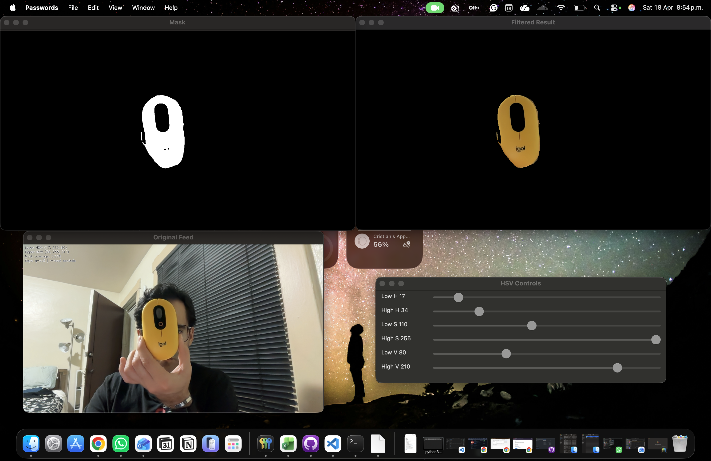

# Real-Time Color Detection

A Python/OpenCV command-line tool for tuning HSV color thresholds against a live webcam feed.

[](https://github.com/crisdanrodriguez/realtime-color-detection/actions/workflows/tests.yml) [](https://www.python.org/) [](https://opencv.org/) [](LICENSE) [](https://github.com/crisdanrodriguez/realtime-color-detection/commits/main/)

**Created:** 2022-01-27 | **Last Updated:** 2026-04-19

The dates are GitHub repository creation and latest default-branch commit dates as checked for this README; the last-commit badge updates dynamically.

## Overview

This project provides an interactive way to select HSV bounds for color masking. It is intended for computer vision prototyping and learning: a webcam feed, binary mask, and filtered image are displayed side by side so changes to the thresholds can be inspected immediately.

The application uses OpenCV trackbars for calibration and applies the selected range to each camera frame. It is a local, camera-based utility; the repository does not include a dataset, trained model, or object tracking pipeline.

## Key Features

- Adjust lower and upper HSV bounds with live trackbars or set their initial values through the CLI.
- View the annotated camera feed, binary mask, filtered result, and HSV controls in separate windows.
- Apply optional Gaussian blur and morphological opening and closing to reduce mask noise.
- Select a camera index and backend, request capture dimensions, and disable the default horizontal mirror.
- Reset the sliders to the initial CLI bounds with `r`; quit with `q`.

## Tech Stack

- **Language:** Python 3.10 or newer
- **Libraries:** OpenCV 4.x (`opencv-python`) and NumPy
- **Packaging and tests:** setuptools and pytest
- **CI:** GitHub Actions runs unit tests on Python 3.10, 3.11, and 3.12

## Methodology

For each captured frame, the application optionally mirrors and blurs the image, converts it from BGR to HSV, and thresholds it with the current trackbar values. Optional morphological opening and closing clean the binary mask. OpenCV then uses the mask to display only the matching pixels from the original frame. The feed overlay shows the active bounds, mask coverage, and camera backend.

On macOS, automatic backend selection tries AVFoundation before OpenCV's default backend. The app checks that the selected camera delivers frames and warns when frames remain very dark. See the [implementation notes](docs/implementation-notes.md) for the runtime flow.

## Getting Started

### Prerequisites

- Python 3.10 or newer
- A working webcam, camera access permission, and a desktop environment that can display OpenCV windows

### Install

From the repository root:

```bash
python3 -m venv .venv
source .venv/bin/activate
python -m pip install .
```

For development, install the test dependency instead:

```bash
python -m pip install -e '.[dev]'
```

Alternatively, install the runtime libraries without installing the package:

```bash
python -m pip install -r requirements.txt
```

In that case, use the module command below from the repository root.

### Run

```bash
realtime-color-detection
```

Alternatively:

```bash
python -m realtime_color_detection
```

### Run tests

After installing the development dependencies:

```bash
python -m pytest -v
```

The tests cover the argument parser and HSV utilities. They do not exercise webcam capture or the OpenCV GUI.

## Usage

Start with the default camera and adjust the six HSV sliders while watching the mask and filtered result. Press `r` to restore the bounds supplied at startup (or the full HSV range if no bounds were supplied), and `q` to exit.

For example, to start with a narrower HSV range and request a capture size:

```bash
realtime-color-detection \
  --camera 0 \
  --backend auto \
  --width 1280 \
  --height 720 \
  --lower-hsv 35,80,80 \
  --upper-hsv 85,255,255 \
  --blur-kernel 5 \
  --morph-kernel 5
```

These values are example initial settings, not calibrated values for a particular camera or scene. OpenCV requests the specified capture size; the camera may use a different supported size. Use `--backend any` to select OpenCV's default backend, or `--backend avfoundation` on a system that supports it. Use `--no-mirror` to keep the camera's original orientation. Run `realtime-color-detection --help` for all options.

## Project Structure

```text
realtime_color_detection/     Application loop, CLI, camera handling, and HSV processing
tests/test_core.py            Parser and utility tests
docs/demo.png                 Existing application screenshot
docs/implementation-notes.md Runtime flow and scope
pyproject.toml                Package metadata, dependencies, and CLI entry point
requirements.txt              Runtime library requirements
.github/workflows/tests.yml   Unit test workflow
LICENSE                       MIT license
```

## Demonstration

The [existing screenshot](docs/demo.png) shows the camera feed, HSV controls, mask, and filtered output with one set of manually selected thresholds. It is an illustrative example, not a measured accuracy or performance result.



## Project Status

This is a small, functional prototype for interactive webcam-based HSV calibration. Automated tests cover non-GUI behavior; camera access and visual output depend on local hardware, permissions, and lighting and are not validated by CI.

AI tools assisted with repository structure, packaging, tests, and documentation, as disclosed in the previous README.

## License

Released under the [MIT License](LICENSE).
